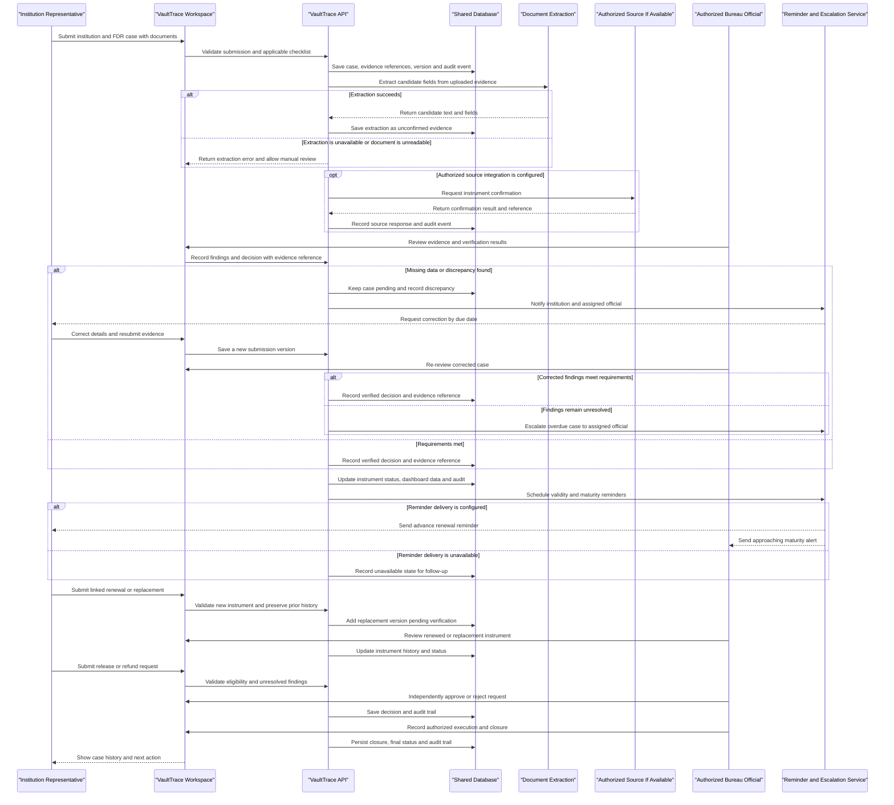

# Core Business Workflows

VaultTrace is intended to provide a secure, institution-wise registry and controlled administrative lifecycle for security deposits and fixed deposit receipts (FDRs) associated with AICTE approval-related processes. This map separates the complete workflow sought in the problem statement from the narrower capabilities currently implemented in the prototype.

## SIH Problem Statement Workflow Map

### Recommended end-to-end workflow

**Configure rules and users** → **Institution submits an FDR/deposit case with prescribed documents** → **Portal validates completeness and policy requirements** → **Create a traceable pending case** → **Check evidence and verify instrument details** → **Resolve discrepancies and re-submit if needed** → **Authorized official records verification decision** → **Track active instrument, validity, maturity, renewal, and replacement** → **Process a separately authorized release/refund** → **Close the case with evidence and audit history**

1. **Configure:** An authorized administrator maintains current deposit requirements, prescribed document checklists, institution assignments, roles, and approval responsibilities.
2. **Submit:** An institution submits an approval-related security-deposit/FDR case, instrument details, confirmation documents, and other prescribed records. The portal creates a case reference and records the submission time and submitting institution.
3. **Validate and register:** The portal checks required fields/documents, formats, dates, duplicates, institution/programme association, and the applicable policy. Valid cases enter verification; incomplete cases remain pending with actionable reasons for correction.
4. **Review and verify:** A reviewer checks the uploaded evidence and instrument data. Where an authorized integration exists, the portal requests confirmation from that source and records its result and reference. Without such an integration, the reviewer uses approved manual evidence and records the limitations; OCR is only an aid to review.
5. **Resolve exceptions:** Missing, inconsistent, expired, or otherwise questionable data becomes a traceable discrepancy. The institution receives a request for correction; resubmission preserves prior versions, findings, decisions, and timestamps. Escalate overdue pending cases to the assigned authorized official.
6. **Approve and monitor:** An authorized official records the verification outcome. Approved instruments enter the active repository and dashboard. The system tracks issue/validity/maturity dates and notifies the institution and responsible official at configured intervals; overdue renewal or review cases are escalated.
7. **Renew or replace:** The institution submits the renewed/replacement instrument before expiry, linked to the existing instrument. The portal preserves both the prior and submitted versions and sends the new instrument through validation and verification before it supersedes the old one.
8. **Release or refund:** The institution submits a release/refund request with prescribed supporting records. The authorized office checks applicable rules and unresolved findings, records an independent approval/rejection, then an authorized executor records the payment/release evidence. A separate reviewer closes the case.
9. **Report and audit:** Dashboards and reports show institution and instrument status, pending cases and their age, approaching/overdue maturities, renewal/replacement outcomes, and released/refunded instruments. Submission, access, evidence, verification, changes, alerts, decisions, and closure are attributable in the audit history.

### Problem-statement capability mapping

| Problem-statement capability | Workflow step | Prototype mapping and current limitation |
|---|---|---|
| 1. Centralized institution-wise and instrument-wise repository | Submit, register, monitor | Institution and FDR directories, linked documents, statuses, and a database-backed dashboard exist. |
| 2. Secure digital document management | Submit and review | Private PDF/PNG/JPEG upload, retrieval, hashing, and local extraction exist. Evidence must attach to an existing FDR record in the current flow. |
| 3. Verification and discrepancy detection | Review and resolve | Reviewer decisions and manually recorded discrepancies exist. Authorized bank/system verification is not integrated; there is no complete automatic discrepancy engine. |
| 4. Validity, maturity, and advance reminders | Monitor and escalate | Maturity dates can be listed and notification records scheduled. There is no separate instrument-validity/expiry field, background scheduler, or email/SMS delivery; validity windows and escalation require completion. |
| 5. Renewal and replacement history | Renew or replace | A verified FDR can enter draft review with a linked version snapshot. The current action does not itself accept, register, and verify a replacement instrument as a completed renewal. |
| 6. Release/refund request and tracking | Release or refund | Request, decision, execution, and closure stages exist with role checks and separation of duties. Confirm application-specific prescribed rules and evidence before production. |
| 7. Automated alerts and escalation | Resolve and monitor | Notification records and an unavailable state exist; automated dispatch, deadline triggers, and escalation routing are not implemented. |
| 8. Consolidated dashboards and reports | Monitor and report | Dashboard aggregates, maturity listing, audit view, and CSV export exist. The dashboard does not yet demonstrate every requested lifecycle category or prove improvements. |
| 9. Audit trail and access control | All steps | JWT roles, institution memberships, and audit records for core actions exist. Validate all sensitive read/access events and the complete production role matrix. |
| 10. Authorized integrations and data security | Verification and all data handling | Private file handling, access controls, and local database support exist. Bank/legacy-system integrations and production storage, secrets, and operational security are not delivered. |

### Measurable SIH evaluation

Compare a documented manual-process baseline with a pilot using the same case types and observation period. Report the measured values rather than claiming improvement without baseline evidence.

| Outcome | Suggested measure |
|---|---|
| Record accuracy | Required-field/document completeness on first submission; number of corrected fields per case. |
| Verification turnaround | Median and 90th-percentile time from complete submission to decision. |
| Timely renewal monitoring | Share of eligible instruments with renewal/replacement submitted and verified before expiry. |
| Reduced manual tracking | Staff minutes spent per case on status tracking and reminder follow-up. |
| Pending-case visibility | Count and age distribution of pending cases, unresolved discrepancies, and overdue actions. |
| Accountable processing | Share of decisions/executions with actor, timestamp, evidence reference, and required independent approver. |

## Domain Entities

| Entity | Service / Bounded Context | Description | Key Relationships |
|---|---|---|---|
| Institution | Institution Directory | Organization associated with security deposits and instruments. | Has programmes and FDRs; users can be assigned through institution memberships. |
| Institution Programme | Institution Directory | Programme catalogue entry associated with an institution. | Belongs to an institution. |
| User and Institution Membership | Access and Operations | Authenticated actor with a role and, where applicable, institution-scoped access. | Membership links a user to an institution; actors create and review workflow records. |
| Policy Rule and Deposit Assessment | Policy and Assessment | Time-bounded policy configuration and an assessment of an institution's deposit amount against a selected rule. | Assessment references an institution and optionally a policy rule. |
| FDR | Instrument Registry | Registered security-deposit instrument and the central record for its lifecycle. | Belongs to an institution; anchors evidence, verification, discrepancies, provenance, versions, custody, notifications, and release requests. |
| Document, Extraction Result, and FDR Intake | Evidence and Intake | Private uploaded PDF/image, extracted text, and an optional incomplete set of candidate fields for later completion. | Document belongs to an FDR; extraction and intake reference their source document. |
| Field Provenance | Evidence and Review | Records how a field value was declared, extracted, reviewed, or independently confirmed. | Belongs to an FDR and can reference a supporting document and reviewer. |
| Verification Case and Discrepancy | Verification and Scrutiny | Reviewer decision and individual finding requiring resolution or an explicitly authorized waiver. | Both reference an FDR; a discrepancy may be resolved or waived. |
| Release Request | Release and Refund | Request to release or refund a verified deposit, including its decision and execution stages. | Belongs to an FDR; records requester and approver. |
| Instrument Version and Lifecycle Event | Instrument Lifecycle | Version snapshot for initial registration or proposed renewal/replacement, and a record of status changes. | Belongs to an FDR; a new version can link to its predecessor. |
| Custody Event and Notification Event | Custody and Monitoring | Recorded custody movement or planned notification related to an instrument. | Each references an FDR. |
| Audit Event | Governance and Audit | Actor-attributed record of significant business actions and exports. | Records the action against the affected business entity. |

## Service-to-Domain Mapping

The prototype is a single React/TypeScript frontend calling a FastAPI backend backed by a shared SQL database; these are application tiers, not separate business microservices.

| Service | Domain Context | Owned Entities | External Dependencies |
|---|---|---|---|
| VaultTrace web application | Operations workspace | No independent system of record; presents institution, registry, evidence, verification, lifecycle, and governance workflows. | Calls the VaultTrace API. |
| VaultTrace API | Institution Directory; Access; Policy and Assessment; Instrument Registry; Evidence; Verification; Release; Custody; Governance | All business entities listed above; enforces role and institution access for its routes. | Shared SQL database; local PyMuPDF/Tesseract extraction; optional OpenAI extraction during draft conversion when configured. |
| External bank, delivery, and storage providers | Not implemented as integrated services | No provider-owned entities in this prototype. | Live bank confirmation, email/SMS delivery, production object storage, and secrets management are deployment-specific dependencies, not completed workflow steps. |

## Prototype Workflows (Current Code)

The following workflows describe the implemented behavior, not capabilities implied by the broader SIH target workflow above.

### Workflow 1: Institution and policy preparation

1. An authorized administrator or officer finds or creates an institution; a CSV can be previewed for required columns, duplicate codes, and row errors before import.
2. An administrator configures a policy rule with its effective dates, optional expiry, amount floor, version, and required-document list, then activates it only within its valid time period. Activating a version deactivates active siblings for the same rule.
3. An administrator or officer records a deposit assessment for an institution. The assessment is marked `configured` only when the chosen policy is active, currently effective, not expired, and the amount meets its floor; otherwise it is `policy_required`.
4. The prototype stores the policy's required-document list but the assessment path does not enforce each listed document. Treat assessment status as a policy/amount check, not a complete eligibility decision.

### Workflow 2: FDR registration and evidence analysis

1. An authorized officer creates a full FDR record against an existing institution. The API validates required fields, positive principal, IFSC format, maturity after issue date, lien text when lien endorsement is selected, and uniqueness of the FDR identifier. Registration creates the initial version and lifecycle event in `draft`.
2. The officer uploads a supporting PDF, PNG, or JPEG to that existing FDR. The API checks the accepted media type, configured size limit, and duplicate SHA-256 hash; uploaded content is stored privately.
3. An authorized user extracts document text. PDFs with embedded text use PyMuPDF; scanned PDFs and images use Tesseract. Missing Tesseract or unreadable files produce an error rather than a successful extraction claim.
4. The user can convert extracted text into candidate FDR fields using local parsing and, only when configured, optional OpenAI extraction. Candidate values must be reviewed; extraction is not authenticity verification.
5. The user may save available candidates as a pending incomplete intake linked to its source document and FDR. It does not create, register, verify, or complete an FDR; the source document must already belong to an existing FDR.
6. Documents, extracted text, and field provenance remain associated with the instrument for later scrutiny.

### Workflow 3: Verification and discrepancy handling

1. An officer submits a draft to the review queue. A reviewer moves a submitted instrument into review or rejects it; the reviewer can record verification as in-review, clarification, verified, or rejected.
2. A reviewer records discrepancies with their rule, severity, explanation, expected value, and observed value. A reviewer can resolve a finding with notes; only an administrator can waive one.
3. A terminal verification decision (`verified` or `rejected`) requires an evidence reference. A verified decision changes the FDR lifecycle status to `verified`.
4. Provenance can distinguish declared (`L0`), extracted (`L1`), reviewed (`L2`), and independently confirmed (`L3`) values. Only an administrator or reviewer may record independent confirmation.
5. OCR output, parsed candidates, and an evidence reference are not live bank confirmation; the prototype has no authorized bank confirmation integration.

### Workflow 4: Controlled release or refund

1. An officer requests release or refund only for a verified instrument and provides the request reason/type. The API blocks a second active pending/approved request and blocks requests while open discrepancies remain.
2. A different administrator or reviewer approves or rejects the pending request. The requester cannot approve their own request; rejection moves the FDR to `rejected`.
3. An independent administrator or officer records execution evidence for an approved request. Neither the requester nor approver may execute it.
4. An independent administrator or reviewer records closure evidence after execution. The executor cannot close their own execution.
5. Request, decision, execution, closure, and instrument status changes are recorded for audit/lifecycle review.

### Workflow 5: Ongoing monitoring and governance

1. Users with access review maturity dates and instrument status; officers may schedule notification records.
2. Notifications are persisted as planned records. The prototype can mark them unavailable with a reason; it does not send email or SMS.
3. Authorized custody staff record custody events against an instrument.
4. Authorized users export institution-scoped instrument data; exports are audited. Administrators and auditors can inspect audit events.
5. For a verified instrument, an officer may request renewal or replacement with a reason and proposed identifier/maturity. The original instrument is preserved, a linked version snapshot is created, and scrutiny reopens in `draft`; the proposed terms are not automatically registered as a new verified instrument.

## Cross-Service Data Flows

There are no business-service-to-business-service calls: all workflow records are persisted through the VaultTrace API to a shared database, and the frontend composes the operator's workspace from those API responses.

The principal flow links an institution to an FDR; the FDR anchors private documents, extraction results, candidate intake, field provenance, reviewer findings, verification, release/refund, custody, notification, maturity, version, lifecycle, and audit records. Institution memberships scope many list and detail operations; administrators and auditors have broader institution visibility where the API allows it.

Text extraction is local in the extraction endpoint. During document-to-draft conversion, configured OpenAI extraction may be used alongside local parsing; the README notes that document text is sent to OpenAI only when an API key is configured. No external bank API confirms instrument authenticity, and no mail/SMS provider delivers notifications. Unavailable OCR raises an error; unavailable notification delivery is recorded as unavailable rather than delivered.

## Business Workflow Sequence

The sequence below is the recommended SIH target process. The authorized-source and notification branches are proposed integration points, not currently implemented integrations.

<!-- mermaid-checked: every participant uses `participant Id as "Label"`, no \n in aliases/messages/notes, every alt/opt/loop closed by end, no `:` inside any alias -->

## Business Rules & Decision Logic

- **Access control:** Protected operations require authentication and route-specific roles. Institution-scoped users must have a membership for the target institution; administrator and auditor visibility is broader on applicable queries.
- **Institution integrity:** Institution codes and FDR identifiers are unique. CSV preview identifies missing required name/code values and duplicate institution codes; import is blocked while preview errors remain.
- **Policy timing and assessment:** A policy cannot be activated before its effective date or at/after expiry. Activating a version deactivates active sibling versions with the same rule identifier. Assessment is `configured` only with a current active policy and an amount meeting its floor; otherwise it is `policy_required`.
- **FDR validation:** Registration requires a positive amount, a valid IFSC pattern, maturity later than issue date, and a lien clause when lien endorsement is selected. Supporting files are limited to PDF/PNG/JPEG, the configured upload-size cap, and one stored copy per SHA-256 content hash.
- **Evidence confidence:** Extracted fields are candidates, not verified facts. Terminal verification outcomes require a traceable evidence reference; only an administrator/reviewer may record `L3` independent confirmation. Live bank authentication is not implemented.
- **FDR lifecycle:** Normal transitions are `draft -> submitted -> under_review -> verified` or `rejected`; verified instruments may enter `release_requested`, followed by `approved` or `rejected`, then `executed -> closed`. Role restrictions apply to transitions. Administrators cannot approve their own FDR record.
- **Discrepancies:** Release/refund requests are blocked by any open discrepancy. Reviewers resolve findings; administrators alone can waive them.
- **Release separation of duties:** Only verified FDRs can be requested for release/refund; at most one pending/approved request can exist for an instrument. Requester, approver, executor, and closer are subject to independent-actor checks at the corresponding stages.
- **Renewal/replacement:** Only verified FDRs may enter this review; proposed maturity must be later than current maturity and proposed identifier must be unused. The action creates a version snapshot and returns the instrument to draft for renewed scrutiny.
- **Monitoring and audit:** Custody records and important mutations/exports are persisted with actor and action context. Notifications are planned records, not proof of dispatch. Dashboard, maturity, institution, and export data are scoped according to the user's role and institution memberships where implemented.
- **Persistence boundary:** Each business action is handled by the single backend API and shared database. External bank confirmation, production object storage, secrets management, and email/SMS delivery are outside the current prototype.
